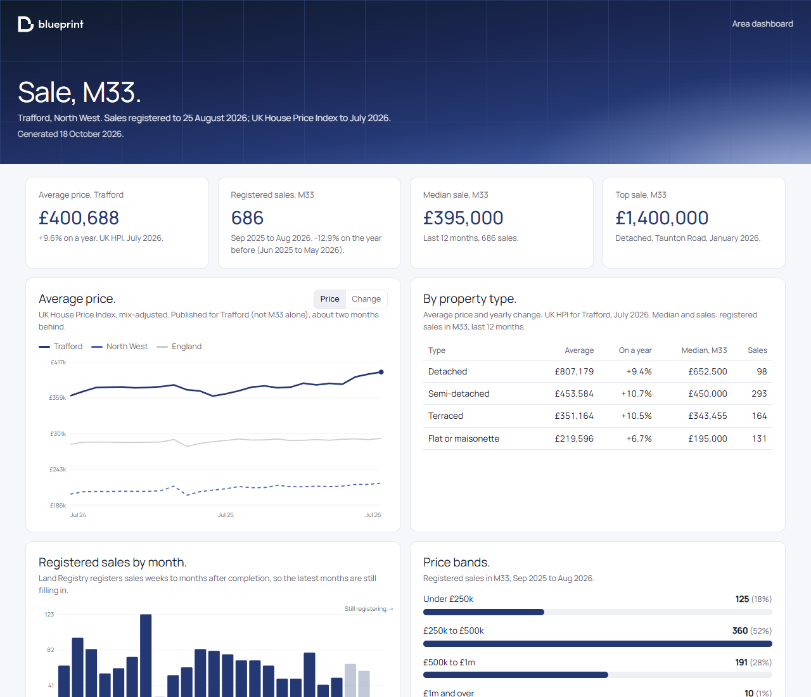

# Blueprint for Claude

**The property answers you need, in Claude.** A free Claude skill from
[Blueprint Property Marketing](https://blueprintpropertymarketing.com) for estate agents, letting agents, landlords,
developers, investors and anyone who markets property in England and Wales.

Give it any address and it tells you what the home has sold for since 1995, what that price is on today's index,
what comparable homes nearby sold for, and whether an asking price stacks up. It gives the area's rents and yields,
the local facts a listing needs (flood risk, broadband, conservation areas, listed buildings, coal mining, schools and
stations), and a full area dashboard. Give it your website or logo and every page carries your logo and colours. It's
built from official open data. No API keys, no spreadsheets, nothing to set up beyond the upload.

## What it does.

- **Address check.** Every registered sale of a home since 1995, its last price brought forward on the UK House Price
  Index for its council area and property type ("on today's index", not a valuation), and the nearest comparable
  sales of the same type, each brought to today's index. A branded property report for a valuation or a vendor.
- **Asking-price check.** Where any asking price sits among those comparables, for stuck listings, relaunches and
  buyers wondering what to offer. Claude can review the listing itself from screenshots.
- **Rents and yields.** ONS average rents for the council area by bedrooms and property type, the change on a year,
  and gross yields by type. For rent reviews, landlords deciding whether to sell, and investors.
- **Local facts and material information.** For any postcode: flood risk from rivers and the sea, broadband and
  mobile, conservation area, Article 4, green belt, national park or National Landscape, tree preservation areas,
  listed buildings nearby, coal mining high-risk areas, the nearest schools and stations, and the National Trading
  Standards material information checklist, showing what the data fills in and what the seller supplies.
- **Area dashboard.** Price trends against the region and England, houses against flats over ten years, sales by
  month and type, price bands, rents and yields, new-build schemes, a street map, and every sale since 2021 to search.
- **Side by side.** Two or three areas compared: prices, sales, medians type by type, price bands.
- **For developers.** New-build schemes against established homes, unit mix, brownfield register sites, constraints
  at a site.
- **Area guides and AI search.** The facts for an area page for every town you cover, and a check of how you show up
  when buyers ask AI assistants for local agents.
- **Writing from the numbers.** Vendor updates, price conversations, rent-review letters, landlord newsletters, board
  papers, LinkedIn posts: Claude writes them from the real figures, with the sources.
- **In your branding.** Share your website and pages use your logo and brand colour, or attach your logo.

## Install it.

About two minutes, on Claude's Free, Pro, Max and Team plans.

1. Download **`blueprint.zip`** from the [latest release](https://github.com/Blueprint-Property-Marketing/blueprint-skill/releases/latest).
   Leave it zipped.
2. In Claude, open **Settings → Capabilities**, check **Code execution and file creation** is on, and switch on **Allow network egress** (so Claude can download your area).
3. Open **Customize → Skills**, click **+ Add → Upload skill**, and pick
   `blueprint.zip`. Make sure the toggle next to Blueprint is on.
4. Start a new chat and type: **"Blueprint: my area dashboard for M33, our site is yourcompany.co.uk"**
   (your own postcode district and website).

On Enterprise plans, an admin may need to allow network egress first. If Claude
says it can't download the data, use the area file below instead.

Using Claude Code? Copy `skills/blueprint` into `~/.claude/skills/blueprint`.

## Where it works.

Any address, postcode or place in England and Wales: all 2,288 postcode districts with registered sales,
4,608,851 sales since January 2021, and the earlier history of 14,188,579 homes back to 1995. Data is refreshed each month; your installed skill picks up the new
figures automatically.

**If Claude can't download the data:** from the
[latest release](https://github.com/Blueprint-Property-Marketing/blueprint-skill/releases/latest), download the
file for the letters at the start of your postcode (`blueprint-areas-M.zip` for M33, `blueprint-areas-SK.zip` for
SK7), attach it to your chat, and ask Claude to use it.

## The data.

- **HM Land Registry Price Paid Data.** Every standard residential sale in England and Wales registered since
  January 2021 (to 2026-08).
  Sales are registered weeks to months after completion, so the latest months are always incomplete;
  the dashboard marks them as still registering.
- **UK House Price Index.** Published for the local authority, about two months behind. Every price
  trend comes from the index, because medians move with the mix of homes sold.
- **Postcode locations** for the map, and each area's region, from the ONS Postcode Directory.
- **Rents:** the ONS Price Index of Private Rents, by council area, bedrooms and property type.
- **Flood risk:** the Environment Agency's postcodes in areas at risk of flooding from rivers and the sea (England).
- **Broadband and mobile:** Ofcom Connected Nations 2025.
- **Planning and heritage:** the Planning Data platform (conservation areas, Article 4 directions, green belt, tree
  preservation, national parks, National Landscapes, listed buildings, scheduled monuments, brownfield land), with
  Historic England and Natural England data (England).
- **Coal mining:** the Mining Remediation Authority's Development High Risk Areas.
- **Schools and stations:** Get Information about Schools (DfE, England) and NaPTAN (DfT).
- **The street map** under the dots: roads, rivers, parks and place names from Ordnance Survey OpenData
  (OS Open Roads, OS Open Rivers, OS Open Greenspace, OS Open Names).

Contains HM Land Registry data © Crown copyright and database right 2026. This data is licensed under
the [Open Government Licence v3.0](https://www.nationalarchives.gov.uk/doc/open-government-licence/version/3/).
Postcode locations contain OS data © Crown copyright and database right 2026, and Royal Mail data
© Royal Mail copyright and database right 2026. Source: Office for National Statistics, OGL v3.0.
The street map contains OS data © Crown copyright and database right 2026, licensed under the Open
Government Licence v3.0.
Rents: Source: Office for National Statistics, OGL v3.0. Flood risk: contains Environment Agency information ©
Environment Agency and/or database right. Broadband and mobile: contains Ofcom data. Planning and heritage: contains
public sector information licensed under the OGL v3.0, including Historic England and Natural England data © Crown
copyright and database right. Coal mining: contains Mining Remediation Authority data. Schools: Department for
Education. Stations: Department for Transport. All under the Open Government Licence v3.0.

Price Paid Data contains address data processed against Ordnance Survey's AddressBase Premium product,
which incorporates Royal Mail's PAF database. Royal Mail and Ordnance Survey permit use of this address
data for personal and/or non-commercial use, and to display for the purpose of providing residential
property price information services. For any other use, contact Royal Mail
(address.management@royalmail.com).

Nothing here is a valuation, and Blueprint Property Marketing is not affiliated with HM Land
Registry. Check figures before you rely on them.

## Privacy.

The skill runs inside your own Claude account. Blueprint Property Marketing can't see your chats,
your files or what you ask.

- **What it downloads.** Area data and its display text (such as the panel at the foot of the
  dashboard) from this public repository on GitHub, and only the areas you ask for. GitHub handles
  that download under its own privacy terms; the request comes from wherever Claude runs the skill.
- **What it sends to Blueprint.** Nothing. There are no accounts, no tracking, no analytics and no
  cookies, and nothing is sent back to us.
- **The dashboard.** One file, created in your chat, with everything it needs inside it. It makes no
  network requests when you open it.
- **Your website and logo.** If you give your website, the skill reads its public homepage,
  stylesheets and logo to take your name, logo and brand colours. If you attach a logo, it reads
  that file. Either way they are used only in your dashboards, in that chat, and aren't stored
  anywhere else.
- **Links to us.** Links to Blueprint Property Marketing's website are tagged so we can see that a
  visit came from the skill, never who you are. Email links open with a subject line saying they
  came from the skill. Anything you send us, or do on our website, is covered by our usual privacy
  policy.
- **Your chats.** What you type and attach in Claude is covered by Anthropic's terms and your
  Claude settings, not by us.
- **The sales data.** HM Land Registry publishes the address and price of every sale as public
  record. The skill holds no names and shows addresses only as price information.

Privacy questions: sam@blueprintpropertymarketing.com

## Who made it.

Blueprint Property Marketing designs brochures, ads, websites and campaigns for estate agents,
developers and investors. [blueprintpropertymarketing.com](https://blueprintpropertymarketing.com)

## Licence.

**Free to use, not to copy.** You can install the skill and use it, and everything it produces, for
your own work and your business, at no cost. You can't copy, republish, sell, rebrand or build on it,
or remove the Blueprint name and credits, without our written permission. The full terms are in
`LICENSE`.

The area data stays under the Open Government Licence v3.0, with the address-data condition above.
The Manrope font is under the SIL Open Font License 1.1 (`skills/blueprint/assets/OFL-Manrope.txt`).
The Blueprint name and logo are trade marks of Blueprint Property Marketing.

Permission requests: sam@blueprintpropertymarketing.com
